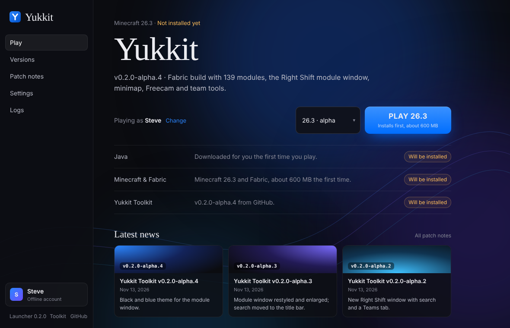
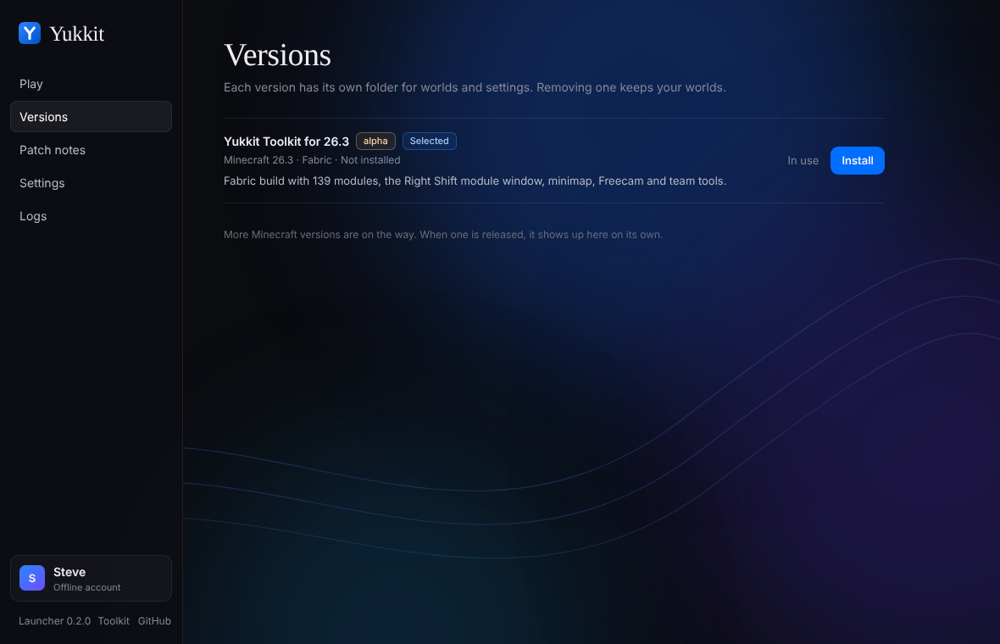
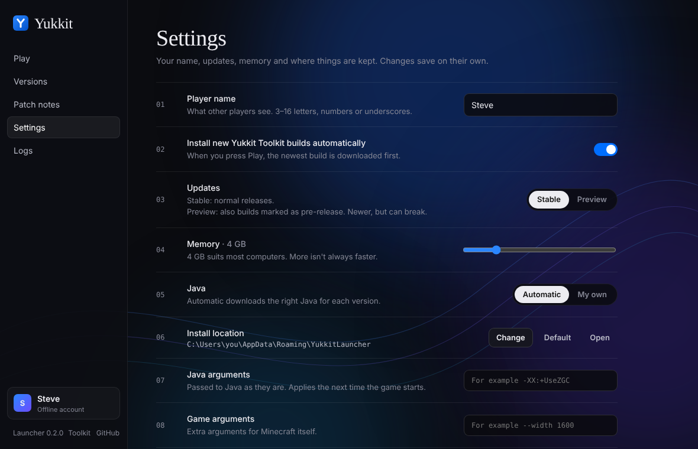

<div align="center">


# Yukkit Launcher

**Install, update and play Yukkit Toolkit with one button.**

[](versions.json)
[](https://fabricmc.net/)
[](https://github.com/YukkitMC/yukkit-laucher/actions/workflows/build.yml)
[](LICENSE)

**[Download](https://github.com/YukkitMC/yukkit-laucher/releases/latest) • [Yukkit Toolkit](https://github.com/YukkitMC/yukkit-toolkit) • [Contributing](CONTRIBUTING.md) • [Security](SECURITY.md)**

</div>

<p align="center">
  
</p>

---

## What it does

The Yukkit Launcher is a small desktop app, written in Rust with Tauri. It sets up everything [Yukkit Toolkit](https://github.com/YukkitMC/yukkit-toolkit) needs, so you never have to deal with mod loaders or Java.

- **One button.** Press **Play**. The first time, the launcher installs Java, Minecraft, Fabric, Fabric API and Yukkit Toolkit. After that, it updates what changed and starts the game.
- **Pick your version.** Choose a Minecraft version next to the Play button. Today that's **26.3**, and new versions show up on their own when they're released.
- **Always up to date.** The newest Yukkit Toolkit build is installed when you press Play. You can turn this off or opt into preview builds.
- **You can see what it's doing.** Six clear steps with a progress bar, file counts and download sizes.
- **Problems in plain words.** No internet, a full drive, a folder it can't write to, missing Java or a game crash each get a short explanation and a **Try again** button. Technical details stay one click away.
- **Plays offline.** If GitHub or Mojang can't be reached, the launcher starts the version you already have.
- **Leaves your stuff alone.** Each version has its own folder for worlds, settings and your own mods. Removing a version keeps your worlds.

<table>
  <tr>
    <td></td>
    <td></td>
  </tr>
  <tr>
    <td align="center"><sub>Versions: each one installs into its own folder</sub></td>
    <td align="center"><sub>Settings: name, updates, memory, Java, folders</sub></td>
  </tr>
</table>

> [!WARNING]
> **Some Yukkit Toolkit modules can get you banned** on servers that don't allow them. Yukkit Toolkit is made for anarchy servers. Check a server's rules before you join.

> [!NOTE]
> **Alpha.** The launcher and Yukkit Toolkit are both early builds. Back up worlds you care about.

## Install

1. Download **`Yukkit.Launcher_x.y.z_x64-setup.exe`** from the [latest release](https://github.com/YukkitMC/yukkit-laucher/releases/latest).
   If you'd rather not install it, use **`YukkitLauncher-portable.exe`**.
2. Open it. Windows SmartScreen may warn you because the app isn't code-signed yet. Click **More info → Run anyway**.
3. Set your player name, pick a version, press **Play**.

**Requirements:** Windows 10 or 11 (64-bit), about 1.5 GB of free space, and an internet connection for the first install. You don't need to install Java yourself.

## Where things go

Everything lives in one folder, `%APPDATA%\YukkitLauncher` by default. You can change it under **Settings → Install location**.

```text
runtimes/            Java, downloaded once per version it's needed for
libraries/ assets/   Minecraft files shared by every version
versions/            Minecraft game jars
cache/mods/          downloaded Fabric API and Yukkit Toolkit jars
instances/26.3/      the game folder for 26.3: worlds, options, screenshots, mods
```

You can add your own Fabric mods to `instances/<version>/mods`. The launcher only replaces the files it installed itself.

## How it works

| Step | What happens | Source |
|---|---|---|
| 1. Checking for updates | Finds the newest Yukkit Toolkit build for the version, plus Fabric API and Fabric Loader | GitHub Releases, Modrinth, Fabric Meta |
| 2. Preparing Minecraft | Loads the Fabric profile and the vanilla profile, then merges them | Fabric Meta, Mojang |
| 3. Setting up Java | Uses the Java you chose, or downloads Eclipse Temurin (Java 25 for 26.3) | Adoptium |
| 4. Downloading Minecraft | Client jar and libraries, SHA-1 checked, 16 at a time, with retries | Mojang, Fabric Maven |
| 5. Sounds & textures | Game assets, SHA-1 checked | Mojang |
| 6. Installing Yukkit Toolkit | Copies Fabric API and the Yukkit Toolkit jar into the version's `mods` folder | Modrinth, GitHub Releases |

The launcher then saves a *launch plan*, so the game can start again without an internet connection.

### Adding a Minecraft version

The version list is [`versions.json`](versions.json). The launcher reads it from the `main` branch, so adding a version doesn't need a launcher update:

```json
{
  "id": "26.3",
  "name": "Yukkit Toolkit for 26.3",
  "minecraft": "26.3",
  "fabricLoader": "0.20.1",
  "java": 25,
  "channel": "alpha",
  "description": "Fabric build with 139 modules, the Right Shift module window, minimap, Freecam and team tools.",
  "toolkitRepo": "YukkitMC/yukkit-toolkit",
  "toolkitMatch": "26.3"
}
```

`toolkitMatch` is the text a Yukkit Toolkit release title or its notes must contain to count as a build for that version. Leave `fabricLoader` empty to always use the newest stable loader. A copy of the file is built into the launcher for when GitHub can't be reached.

## Build from source

You need [Rust](https://rustup.rs) (stable) and [Node.js](https://nodejs.org) 18 or newer, which is only used for the Tauri CLI.

```bash
git clone https://github.com/YukkitMC/yukkit-laucher
cd yukkit-laucher
npm install      # Tauri CLI
npm run dev      # run the launcher in development mode
npm run build    # installer in src-tauri/target/release/bundle/nsis/
```

The interface is plain HTML, CSS and JavaScript in [`ui/`](ui), with no bundler. If you open `ui/index.html` in a browser, it shows a preview with sample data, which is handy for working on the design.

```text
ui/                     the interface (index.html, app.js)
  css/tokens.css        design tokens: colors (light and dark), type, spacing
  css/*.css             shared controls, then one stylesheet per screen
  i18n.js               interface language (English, Português, Español)
  i18n-strings.js       translations, keyed by the English text
  cosmetics.js          preset skins and capes, character preview
versions.json           versions the launcher offers
src-tauri/src/
  main.rs               commands the interface calls
  catalog.rs            version list (versions.json)
  sources.rs            Yukkit Toolkit releases (GitHub) and Fabric API (Modrinth)
  installer.rs          install / update / repair, and the saved launch plan
  cosmetics.rs          skin and cape files handed to Yukkit Toolkit on Play
  minecraft.rs          Mojang and Fabric profiles, rules, libraries
  java.rs               Java download and detection
  launch.rs             starts the game and streams its logs
  net.rs                downloads with retries and checksum checks
  errors.rs             turns errors into plain-English messages
  settings.rs           settings file
```

### Releases

GitHub Actions builds the Windows installer and a portable `.exe` on every push. To publish a release, raise `version` in `src-tauri/tauri.conf.json` and `src-tauri/Cargo.toml`, then push to `main`. The workflow creates the release `v<version>` with both files attached.

## Accounts

This version uses **offline accounts**: you play under the name you set in Settings. Servers that require a paid Minecraft account won't accept it. Microsoft sign-in is planned.

## Contributing

Bug reports, ideas and pull requests are welcome. Start with [CONTRIBUTING.md](CONTRIBUTING.md) and the [Code of Conduct](CODE_OF_CONDUCT.md). Report security problems privately, as described in [SECURITY.md](SECURITY.md).

## License

[MIT](LICENSE) © 2026 YukkitMC.

Minecraft is a trademark of Mojang AB. The Yukkit Launcher is not an official Minecraft product and is not approved by or associated with Mojang or Microsoft.
